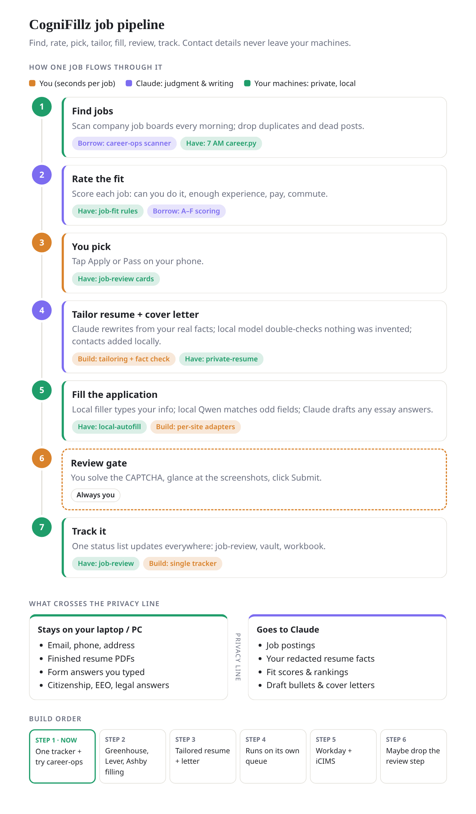

# CogniFillz

A personal job-search pipeline: find jobs, rate the fit, pick, tailor the resume and cover letter, fill the application, review, and track. It's built so most of it runs without you, while your contact details stay on your own machines.



Open [`docs/pipeline.html`](docs/pipeline.html) for the same diagram as a page.

## What works today (step 1)

- **One tracker** (`state/tracker.sqlite`) for every job, from `found` to `offer`, with a dated history of each status change.
- **Imports** from the older trackers: job-review cards and their Apply/Maybe/Pass choices, `Applied_Jobs.md`, and rated role lists (`roles.json`). A posting is matched by URL, then by company and title, so it appears only once.
- **Job board scan** of the companies in your `config/portals.json` through the public Greenhouse, Lever and Ashby APIs. No logins, no AI, no LinkedIn. It keeps software roles that aren't senior and that are in your commute area, remote in the US, or entry-level anywhere in the US (marked "relocate"). Jobs that disappear from a board are closed, and a board that fails to load never touches its jobs.

```sh
bun run cogni scan                # scan every board
bun run cogni scan --dry-run      # show matches without saving
bun run cogni list --entry        # entry-level jobs, newest change first
bun run cogni summary             # how many jobs in each status
bun run cogni choose KEY apply    # or maybe / pass
bun run cogni set KEY submitted --note "submitted on employer site"
bun run cogni import job-review   # also: import applied, import roles FILE
bun test
```

Your places and companies stay out of git. Copy [`config/portals.example.json`](config/portals.example.json) to `config/portals.json` (gitignored), list the towns you can commute to under `localPlaces`, and add companies. To add a company, put its ATS and board slug there, for example `{ "company": "Acme", "ats": "greenhouse", "slug": "acme" }`. The slug is the part after `boards.greenhouse.io/`, `jobs.lever.co/` or `jobs.ashbyhq.com/`.

## Next steps

| Step | What it adds |
| --- | --- |
| 2 | Form filling for Greenhouse, Lever and Ashby (platform adapters in the existing local-autofill tool, plus a local Qwen field mapper) |
| 3 | A tailored resume and cover letter for each job, with a fact check and a side-by-side diff to review |
| 4 | A queue: tapping Apply prepares the documents, fills the form and notifies you |
| 5 | Workday and iCIMS (you handle account creation and logins) |
| 6 | Possibly drop the review step for well-tested sites |

CAPTCHAs, legal and EEO answers, and the final Submit click always stay with you.

## Credits

The scanner's board endpoints and approach follow [career-ops](https://github.com/career-ops-hq/career-ops) (MIT). No career-ops code is vendored.
